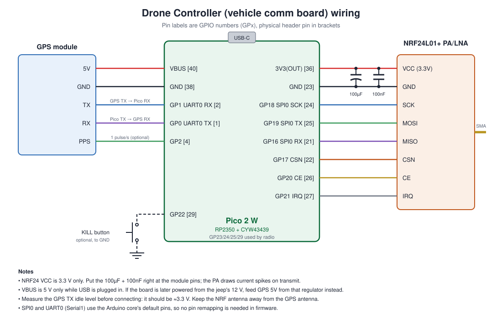

# Drone Controller wiring

Board: Pico 2 W (USB-C variant, same pinout as the Raspberry Pi Pico 2 W; see [pico2w-pinout.svg](pico2w-pinout.svg)).
Pins are given as GPIO numbers (`GPx`) with the physical header pin in brackets.

## GPS module (UART0 / `Serial1`)

| GPS pin | Pico 2 W | Notes |
|---|---|---|
| 5V | VBUS [40] | 5 V only while USB is plugged in |
| GND | GND [38] | |
| TX | GP1 UART0 RX [2] | Check the TX idle level is ≈3.3 V before connecting |
| RX | GP0 UART0 TX [1] | For UBX config commands |
| PPS | GP2 [4] | Optional, 1 pulse per second |

## NRF24L01+ PA/LNA (SPI0)

| NRF pin | Pico 2 W | Notes |
|---|---|---|
| VCC | 3V3(OUT) [36] | 3.3 V only. 100 µF + 100 nF at the module pins |
| GND | GND [23] | |
| SCK | GP18 SPI0 SCK [24] | |
| MOSI | GP19 SPI0 TX [25] | |
| MISO | GP16 SPI0 RX [21] | |
| CSN | GP17 [22] | |
| CE | GP20 [26] | |
| IRQ | GP21 [27] | Active low |

## Optional

| Part | Pico 2 W | Notes |
|---|---|---|
| Kill button | GP22 [29] → GND | Internal pull-up; pressed = low |

## Reserved

GP23, GP24, GP25 and GP29 are used by the CYW43439 wireless chip and are not on the header. The onboard LED is on the wireless chip (`LED_BUILTIN`).

UART0 and SPI0 are the Arduino core's default pins for `Serial1` and `SPI`, so the firmware needs no pin remapping. Pin numbers are also in [`include/pins.h`](../../include/pins.h).
